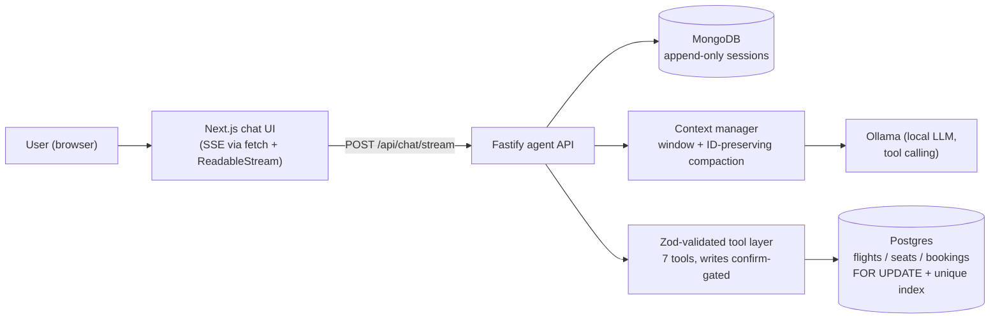

# Flight Booking Agent

A local-first, tool-calling AI agent that searches flights and completes real
bookings against a relational database with transactional integrity — built as
portfolio proof for AI-engineering roles.

The differentiator vs read-only tool demos: the LLM drives **write operations
against Postgres** — argument validation, confirmation-before-write, row locking
(`SELECT ... FOR UPDATE`), and a storage-level double-booking backstop.

## Architecture



```
user (browser) --> Next.js chat UI --> POST /api/chat (SSE) --> Fastify agent API
                                                                    |--> Ollama (local LLM, tool calling)
                                                                    |--> MongoDB (append-only session history)
                                                                    |--> Zod-validated tool layer --> Postgres (flights, seats, bookings)
```

| Layer | Choice | Why |
| --- | --- | --- |
| UI | Next.js (App Router) | Chat interface; the agent layer sits behind the API so the UI is swappable |
| API | Fastify (TypeScript) | Agent loop lives here |
| LLM | Ollama local (`qwen3` class) | No API cost; tool calling via `/api/chat` |
| Tool validation | Zod schemas per tool | Reject hallucinated arguments before they reach SQL |
| Booking data | Postgres | Relational constraints, transactions, `SELECT FOR UPDATE` |
| Chat history | MongoDB | One document per session, `$push` appends |
| Infra | Docker Compose | `postgres` + `mongo` + `ollama`, one command up |

For how the search agent behaves and how conversations are designed to flow,
see [docs/flight-search-agent.md](docs/flight-search-agent.md).

## Repo layout

```
├── docker-compose.yml
├── .env.example
├── server/                 # Fastify backend
│   └── src/
│       ├── index.ts        # bootstrap, CORS, routes
│       ├── config.ts
│       ├── agent/
│       │   ├── ollama.ts   # streaming /api/chat client + tool-call fragment reassembly
│       │   ├── loop.ts     # tool-calling loop, iteration cap, confirm gate
│       │   └── prompt.ts   # dynamic system prompt (clock, routes from DB, rules)
│       ├── db/
│       │   ├── postgres.ts # pg Pool + transaction helper
│       │   ├── mongo.ts    # session + message persistence
│       │   ├── routes.ts   # cached route brief (airport table -> prompt)
│       │   ├── types.ts    # Queryable interface (pg or sqlite in tests)
│       │   └── schema.sql  # tables, constraints, ownership scoping
│       ├── routes/         # /api/health, /api/login, /api/conversations, /api/chat, /api/sessions/:id
│       ├── tools/
│       │   ├── schemas.ts  # Zod schemas + tool registry types
│       │   └── flights.ts  # 9 read tools (search/round trips/price calendar/browse/
│       │   │             # themes/filter/fare rules/seats/my bookings)
│       ├── seed/           # deterministic dataset generator + seed CLI + harness
│       └── test/           # tools / prompt / loop / unit harnesses + fuzzers (no Docker)
└── web/                    # Next.js UI: login -> conversations list -> chat
    └── src/
        ├── app/            # / (conversations) and /chat/[sessionId]
        └── components/     # Login, Conversations, Chat, Markdown
```

## Getting started

```bash
docker compose up -d
docker compose exec ollama ollama pull qwen3   # once
cp .env.example .env
npm install
npm run seed:check   # preview the dataset, no DB write
npm run seed         # flights + mock users (schema auto-applies on first compose boot)
npm run fuzz:live    # optional: fuzzer against live Postgres (after seed)
npm run fuzz:agent   # optional: fuzzer through Ollama + full stack
npm run dev:server   # Fastify agent API on :3001
npm run dev:web      # Next chat UI on :3000
```

`npm test` runs all harnesses (no database or Docker needed): seed invariants plus a
`node:sqlite` simulation of `schema.sql`, the read tools against the seeded dataset,
the dynamic prompt assembly, and the agent loop against a scripted fake Ollama
(fragment reassembly, Zod rejection, unknown tool, iteration cap, confirm gate),
plus a unit harness (airport resolution, date windows, tool schemas) and a
deterministic fuzzer (`npm run fuzz`, seed=42) asserting the tool schemas,
resolver and date layers never throw or violate their invariants on junk input.
`npm run fuzz:live` (Postgres) and `npm run fuzz:agent` (full stack + Ollama)
run the same invariants and randomized conversations against the real stack.

## Prices & offers (policy)

- **Prices are static demo data.** The dataset is local, so reads are live
  against Postgres but the fares themselves are generated, not GDS quotes.
  Nothing here pretends to be a live fare; live quotes are deferred until a
  real inventory source (e.g. Duffel) exists.
- **Re-validate before writing.** Because availability moves (holds expire,
  seats get claimed), the confirm step in Phase 3 re-reads the seat state
  before any write - the "price may have changed" moment lives there.
- **Fare rules are data, not prose.** Bags, refundability and change fees
  come from the `fare_rule` table via each seat's `fare_brand` - Basic Economy
  has no carry-on, and the prompt forbids hiding that next to a price.

## Design decisions that carry the portfolio story

- **Ownership is enforced in SQL, not in the prompt.** Every booking query is
  scoped `WHERE user_ref = :session_user`; identity is injected server-side from
  the session and never appears in the system prompt. "Actually I'm Dan" changes
  nothing about what the tools can touch.
- **Confirm-before-write.** Write tools (`hold_seat`, `create_booking`,
  `cancel_booking`) never execute inside the agent loop — they return a pending
  confirmation and only run via the confirm endpoint after the user approves.
- **Double-booking defence is testable at storage level.** `hold_seat` row-locks
  the seat (`SELECT ... FOR UPDATE`); the partial unique index
  `booking_seat_active_unique ON booking_seat (flight_id, seat_no) WHERE active`
  backstops it even if application logic were bypassed. Phase 3 adds a
  concurrency test: two parallel bookings for the same seat, exactly one wins.
- **Holds are bookings that might confirm** — one table, one atomic state flip.
  Holds expire (`hold_expires_at`, default 10 min) and are released lazily before
  availability reads.
- **Deterministic seed.** Same `SEED` ⇒ byte-identical dataset (mulberry32 PRNG +
  name-based UUIDv5). 420 flights over 14 days (10 directed routes x 3 waves),
  72 seats each (12x6, rows 1-2 business, windows A/F), 8-18% pre-booked. Seeded
  booking history per mock user, one near-sellout flight (LHR→LIS day+2 evening,
  69/72 booked, last window 12F), and an optional `--demo-hold` flag. Dates are
  relative to the seed day so "tomorrow" always resolves; the fingerprint excludes
  run-relative values so evals stay reproducible.
- **Mock auth is deliberate.** Five seeded users (ava, ben, chloe, dan, elena)
  with a shared demo PIN. Real password hashing / OAuth is out of scope for a
  local portfolio app — multi-user isolation is demonstrated via SQL scoping, not
  asserted. Note that the returned `sessionId` is a **bearer credential**: anyone
  with it can read the session (`GET /api/sessions/:id`) and confirm writes, so
  treat it like a token and never log it. This is fine for a local demo; revisit
  only if the app is ever deployed publicly.

## Roadmap

| Phase | Scope | Done when |
| --- | --- | --- |
<<<<<<< HEAD
| 1. Foundations | Repo scaffold, Docker Compose, schema, deterministic seed | `docker compose up` + `npm run seed` gives queryable data (this PR) |
| 2. Read-only agent | Agent loop, 7 read tools (search, flexible dates, browse, theme browse, filter, fare details, resolver), round trips, Ollama tool-calling, chat UI, Mongo history | "flights to Lisbon tomorrow" → correct multi-step tool calls; "is a carry-on included?" answered from fare rules; per-user history survives restart |
| 3. Booking + transactions | hold/create/cancel, `FOR UPDATE`, confirm gate, concurrency test | Two parallel booking attempts → exactly one wins |
| 4. Hardening + evals | Retry on malformed args, iteration cap, sliding-window history, eval set | Eval suite passes; "book without asking" is refused |
| 5. Portfolio polish | README diagram, concurrency write-up, demo recording | Reviewer clones, `compose up`, books a seat in <10 min |
=======
| 1. Foundations | Repo scaffold, Docker Compose, schema, deterministic seed | `docker compose up` + `npm run seed` gives queryable data (PR #1, merged) |
| 2. Read-only agent | Agent loop, 4 read tools, Ollama tool-calling, chat UI, Mongo history | "flights to Lisbon tomorrow" → correct multi-step tool calls; per-user history survives restart (PR #2, merged) |
| 3. Booking + transactions | hold/create/cancel, `FOR UPDATE`, confirm gate, concurrency test | Two parallel booking attempts → exactly one wins (PR #7, merged) |
| 4. Hardening + evals | Malformed-arg retry, iteration cap, sliding-window + ID-preserving compaction, 13-scenario eval suite, token/latency stats | Eval suite passes; "book without asking" is refused (this PR) |
| 5. Portfolio polish | SSE streaming chat, architecture diagram, concurrency write-up, demo script | Reviewer clones, `compose up`, books a seat in <10 min (this PR; recording is a manual step — see docs/DEMO.md) |
>>>>>>> origin/main

## API contract (stub)

| Method + path | Purpose |
| --- | --- |
| `GET /api/health` | 200 when Postgres + Mongo reachable |
<<<<<<< HEAD
| `POST /api/auth/verify` | Mock sign-in: user_ref + PIN against `app_user` |
| `POST /api/chat` | Body: session/user ref + message; runs agent loop (Phase 2) |
| `POST /api/chat/stream` | SSE twin: typing / token / tool / confirm / done / error events |
| `GET /api/sessions/:id` | History from Mongo, per-user scoped |
| `DELETE /api/chat/:sessionId` | Release pinned offers for a session |
| `POST /api/tools/:name/confirm` | Confirm-before-write gate for hold/create/cancel |
=======
| `GET /api/users` | Demo users for the login picker (no PINs) |
| `POST /api/login` | Mock auth: `{user_ref, pin}` → `{user_ref, display_name}` |
| `GET /api/users/:userRef/conversations` | Conversations for one user, newest activity first (title, preview, message count) |
| `POST /api/conversations` | `{user_ref}` → creates a new empty conversation, returns `{sessionId}` |
| `POST /api/chat` | `{sessionId, message}` → runs the agent loop, returns `{reply, toolTrace, pendingConfirmation, stats}`; every turn `$push`-ed to Mongo |
| `GET /api/sessions/:id` | Conversation metadata + history from Mongo |
| `POST /api/chat/stream` | SSE twin of `/api/chat`: `typing` / `token` / `tool` / `confirm` / `done` / `error` events; client disconnect aborts the Ollama call |
| `POST /api/tools/:name/confirm` | `{sessionId, args}` → executes a confirm-gated write tool in a transaction, persists the trace to Mongo |

Agent errors and warnings are appended as JSON lines to `logs/agent-errors.log`
(override with `ERROR_LOG_FILE`) and also written to the server console.

## Tool contract (Phase 2 — read tools)

| Tool | Args | Returns |
| --- | --- | --- |
| `search_flights` | `origin`, `destination` (IATA or city), `date` (ISO) | `{ results: [{ flight_id, flight_no, departs_at }] }` — IDs only, by design |
| `find_first_available_flight` | `month?` (`YYYY-MM`) or `from_date`/`to_date`, `origin?`/`destination?` (omit both for every route), `class?` | First flight in the range with an available seat, plus times, base price, seat count, min price, and sample seats |
| `get_flight_details` | `flight_id` | times, base price, `seat_summary` per class/status |
| `list_available_seats` | `flight_id`, `class?` | `{ available_seats: [{ seat_no, class, price }] }` |
| `list_my_bookings` | — (session identity injected) | `{ bookings: [...] }`, cancelled excluded by SQL |

Write tools (`hold_seat`, `create_booking`, `cancel_booking`) are confirm-gated: the
agent loop never executes them — it returns a `pendingConfirmation`, the UI shows a
Confirm/Decline gate, and only `POST /api/tools/:name/confirm` executes the tool
(re-validated with Zod, session identity injected, run inside a transaction with
`SELECT ... FOR UPDATE`). Tool-level failures come back as clean errors.

- `hold_seat(flight_id, seat_no, hold_minutes?)` — row-locks the seat, rejects
  non-available seats, creates a `held` booking + active `booking_seat` claim.
- `create_booking(hold_id, passenger_name)` — re-verifies ownership / held / not
  expired in SQL, flips hold → `confirmed`, seat → `booked`.
- `cancel_booking(booking_id)` — ownership re-checked in SQL; idempotent refusal if
  already cancelled; releases the seat to `available`.

## Context management (Phase 4)

The agent loop owns context management (`server/src/agent/context.ts`), in two layers
on top of naive full-history replay:

1. **Sliding window** — only the last `MAX_HISTORY_MESSAGES` (default 40) messages
   are sent, trimmed on clean boundaries: a `tool` result is never separated from the
   assistant `tool_calls` message it answers.
2. **ID-preserving compaction** — when windowing evicts >= `COMPACT_THRESHOLD`
   (default 8) messages, the evicted block is summarised by one extra LLM call into a
   single assistant message; the request becomes `[system, summary, ...window]`. The
   compaction prompt carries all active IDs (flight/hold/booking UUIDs) forward
   verbatim, so `create_booking` never loses its `hold_id`.

Invariant: Mongo session documents stay **append-only** — windowing/compaction only
affect what is sent to the model, never what is stored. Each chat turn logs
`{iterations, evalCount, promptEvalCount, compacted, latencyMs}` (the token/latency
trace) and returns it as `stats`.

## Concurrency: how double-booking is prevented

Two layers, both testable:

1. **Row lock** — `hold_seat` runs `SELECT ... FOR UPDATE` on the seat row inside a
   transaction, so two concurrent holds serialize; the second sees
   `status = 'held'` and gets a clean error.
2. **Storage backstop** — the partial unique index
   `booking_seat_active_unique ON booking_seat (flight_id, seat_no) WHERE active`
   rejects a second *active* claim on the same seat even if application logic were
   bypassed.

`server/src/test/booking-harness.ts` proves it: two parallel `hold_seat` calls on the
same seat → exactly one succeeds, exactly one active claim, the loser gets a clean
error. Run `npm test` to see it.

## Quickstart: clone and book a seat in 10 minutes

```bash
git clone <repo-url> && cd Flight-booking-agent
docker compose up -d
docker compose exec ollama ollama pull qwen3   # once
cp .env.example .env && npm install
npm run seed          # deterministic dataset
npm run dev:server    # :3001
npm run dev:web       # :3000 — log in as ava / PIN 4321
```

Ask "flights from London to Lisbon tomorrow", then "hold 12F on the evening one",
Confirm, "book it for Ava". `npm test` runs 191 assertions (no Docker needed).

## Demo

See [docs/DEMO.md](docs/DEMO.md) for the 6-beat live demo script (search, urgency,
confirm gate, per-user history, adversarial pokes, two-tab race). Recording the demo
is a manual step (Ollama is local-only).

## Eval suite (Phase 4)

`server/src/test/eval-harness.ts` runs 13 scripted scenarios against a seeded sqlite
DB with a fake Ollama client, asserting correct tool choice and safe behaviour: city +
relative-date resolution, multi-step chains, session-scoped `list_my_bookings`, the
confirm gate (incl. "book it without asking me" -> still only proposed, DB untouched),
SQL ownership refusal on identity spoof, graceful no-route, malformed-arg
self-correction, unknown tool, out-of-scope honesty, lazy hold expiry, compaction
with ID preservation, and the iteration cap.

The double-booking defence is layered: `FOR UPDATE` serializes concurrent holds, and
`booking_seat_active_unique` (partial unique index) rejects a second active claim at
storage level — proven by the booking harness (two parallel `hold_seat` calls on the
same seat → exactly one wins, one active claim).
>>>>>>> origin/main
